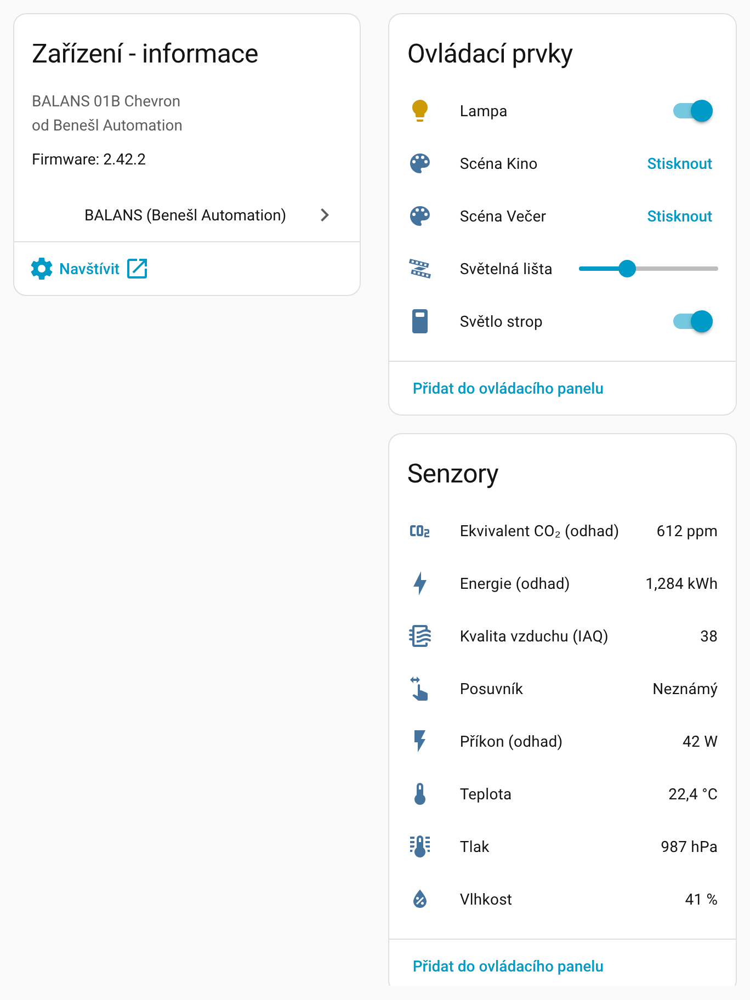
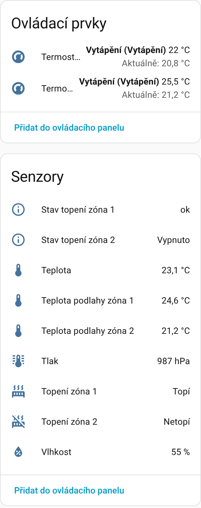
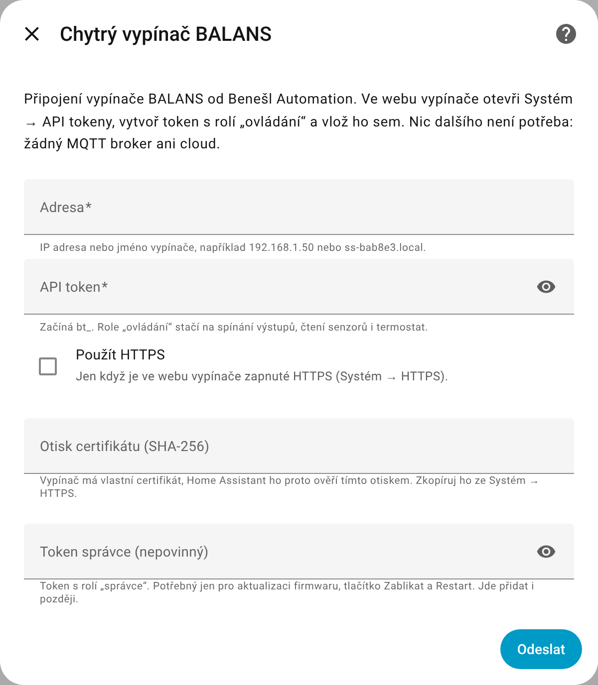

<p align="center">
  <picture>
    <source media="(prefers-color-scheme: dark)" srcset="docs/balans-logo-dark.png">
    
  </picture>
</p>

<p align="center">
  <b>Integrace chytrých vypínačů BALANS pro Home Assistant</b><br>
  od <a href="https://benesl-automation.cz">Benešl Automation</a>
</p>

<p align="center">
  <a href="https://hacs.xyz"></a>
  
  
</p>

---

BALANS je modulární chytrý vypínač do běžné instalační krabice: čelní panel s dotykovými tlačítky, řídicí jednotka a výkonový
modul (relé, stmívač, RGBW, topení a další). Tato integrace ho připojí k Home Assistantu **přímo po místní síti**. Nepotřebuje
MQTT broker ani cloud: vypínač se v síti najde sám a stačí mu vložit API token.

*English summary is at the [end of this page](#english).*

<p align="center">
  
</p>

## Co integrace umí

| Oblast | Entity v Home Assistantu |
|---|---|
| **Výstupy** | Relé a digitální výstupy jako *spínače*, stmívače, RGBW a analogové výstupy jako *světla* (jas, barva RGBW), skupiny DALI (jas, teplota barvy). Názvy se berou z webu vypínače. |
| **Tlačítka panelu** | Entita *událost* pro každé tlačítko: krátký a dlouhý stisk, dvojitý a trojitý dotyk, velmi dlouhý stisk. Další událost pro dvě tlačítka naráz a pro dotyk při zamčeném panelu. Hodí se jako spouštěč automatizací. |
| **Termostat** | Entita *klima*: aktuální a žádaná teplota, režim, co termostat právě dělá (topí, předehřívá, čeká). U modulu 03I-T i **Termostat 2** pro druhou zónu topení. |
| **Světelná lišta** | Na panelu 01B Chevron jde z Home Assistantu nastavit, kolik ukazuje světelná lišta (např. jas světla, které posuvník ovládá jinde v domě). |
| **Senzory panelu** | Teplota, vlhkost, tlak, kvalita vzduchu (IAQ), odhad CO₂, poloha posuvníku. |
| **Energie** | Odhad příkonu a spotřeby (jde přímo do přehledu Energie), frekvence sítě. |
| **Topení** | Stav každé zóny topení, teplota podlahy, důvod, proč zóna topí nebo netopí. U modulu 03I-R za stykačem HDO i *Topný přívod*: zda je na přívodu napětí (firmware 2.43.2 a novější jen se zapnutou volbou *Topení za HDO* ve vypínači; po jejím zapnutí integraci znovu načtěte). |
| **Scény** | Pojmenované scény vypínače jako *tlačítka*. |
| **Dohled** | Porucha (s kódy a texty), zdraví zařízení, síla Wi-Fi, doba běhu, přiblížení ruky (pro ladění citlivosti). |
| **Správa** | S tokenem správce navíc instalace firmwaru, Zablikat (najdete vypínač na zdi) a Restart. |

Všechny názvy entit a texty nastavení jsou **česky i anglicky** podle jazyka Home Assistantu.

<p align="center">
  
</p>

### Bezpečnost topení
Výstupy topných modulů (03I-T, 03I-R) se v Home Assistantu **nikdy neobjeví jako obyčejné spínače**. Home Assistant posílá
termostatu jen přání (žádanou teplotu a režim). Limit podlahy, minimální doby sepnutí a celou bezpečnostní vrstvu hlídá
vypínač sám, i když Home Assistant neběží.

## Instalace přes HACS

1. V Home Assistantu otevřete **HACS → ⋮ (vpravo nahoře) → Vlastní repozitáře**.
2. Vložte adresu `https://github.com/Tomoash/balans-homeassistant`, typ **Integrace**, a potvrďte.
3. Vyhledejte **BALANS**, klikněte na **Stáhnout** a restartujte Home Assistant.

[](https://my.home-assistant.io/redirect/hacs_repository/?owner=Tomoash&repository=balans-homeassistant&category=integration)

### Ruční instalace
Složku `custom_components/balans` z tohoto repozitáře zkopírujte do `config/custom_components/` v Home Assistantu a restartujte ho.

## Nastavení

1. **Token ve vypínači:** ve webu vypínače otevřete *Systém → API tokeny*, zvolte roli **ovládání** a klikněte na Vytvořit.
   Token se ukáže jen jednou, zkopírujte si ho.
2. **Přidání do Home Assistantu:** *Nastavení → Zařízení a služby*. Vypínač se většinou nabídne sám jako *Objeveno*.
   Jinak klikněte na **Přidat integraci** a vyhledejte **BALANS**.
3. Vložte adresu vypínače a token. HTTPS je nepovinné: když ho ve vypínači zapnete, vložte i otisk certifikátu ze
   *Systém → HTTPS*.

<p align="center">
  
</p>

**Token správce (nepovinný):** u integrace klikněte na *Nastavit* a vložte token s rolí **správce**. Používá se jen pro
instalaci firmwaru, Zablikat a Restart. Ovládání dál běží na tokenu role ovládání. Uložený token se už nikdy nezobrazí
a posílá se jen do vypínače.

## Automatizace s tlačítky

Každé tlačítko panelu je entita *událost*. Příklad: dvojitý dotyk na tlačítko „Nahoře“ vypne celé patro.

```yaml
automation:
  - alias: "Dvojitý dotyk vypne patro"
    triggers:
      - trigger: state
        entity_id: event.obyvak_tlacitko_nahore
    conditions:
      - condition: state
        entity_id: event.obyvak_tlacitko_nahore
        attribute: event_type
        state: double
    actions:
      - action: light.turn_off
        target:
          area_id: patro
```

Typy událostí: `short`, `long`, `double`, `triple`, `very_long`; u entity *Dvě tlačítka a zámek* `combo` a `locked`
(atribut `pads` říká, která tlačítka to byla).

## Aktualizace firmwaru

Entita **Firmware** ukazuje nainstalovanou verzi. Integrace firmware **nikdy nestahuje z internetu**. Podepsaný soubor
`smartswitch_ota.bin` od Benešl Automation nakopírujte do složky `config/balans/firmware/` (Samba, SSH nebo File editor).
Do 10 minut se nabídne jako aktualizace a s tokenem správce ji jde nainstalovat. Podpis ověří vypínač sám, a když nový
firmware nenaběhne, vrátí se sám k předchozí verzi.

## Když něco nefunguje

- **Vypínač odmítl token:** Home Assistant sám nabídne zadání nového tokenu (Opravit / Znovu ověřit). Adresa a ostatní
  nastavení zůstanou.
- **Diagnostika:** u integrace ⋮ → *Stáhnout diagnostiku*. Soubor obsahuje, co integrace čte z vypínače; tokeny, adresy
  a síťové údaje jsou z něj odstraněné. Přiložte ho k hlášení chyby.

## Omezení

- Stav se čte každé 3 sekundy. Povel z Home Assistantu platí hned, změna z tlačítka na zdi se v Home Assistantu ukáže do 3 s.
- Dva stejné stisky téhož tlačítka během jednoho čtení přijdou jako jedna událost. Pro časově kritické automatizace má
  vypínač i MQTT, obojí může běžet současně.
- Zálohy a kopírování nastavení mezi vypínači dělá aplikace BALANS Správa na PC, ne Home Assistant.

## Podporovaný hardware

Čelní panely 01 Classic, 01B Chevron, 01C Display, 01D Quad, 01E Sense a 01F (klávesnice Faradite TAP, 5 nebo 6 tlačítek).
Výkonové moduly relé, triak, LED stmívač, RGBW, PoE IO, DALI, žaluzie, 0–10 V, topení 03I-T a 03I-R a modul bez výstupů.
Doporučený firmware vypínače 2.42 a novější; se starším firmwarem integrace funguje, jen bez novějších funkcí.

## Podpora

Výrobce: **Benešl Automation**, [benesl-automation.cz](https://benesl-automation.cz).
Chyby a náměty prosím hlaste přes [Issues](https://github.com/Tomoash/balans-homeassistant/issues).

---

## English

**BALANS** is a modular smart wall switch by [Benešl Automation](https://benesl-automation.cz). This custom integration
connects it to Home Assistant over the local network: no MQTT broker, no cloud. The switch is discovered automatically
(zeroconf); you only paste an API token created in the switch web interface (*System → API tokens*, role **control**).

**Entities:** relays as switches; dimmers, RGBW, analog outputs and DALI groups as lights; an event entity per panel button
(short, long, double, triple, very long press, plus two buttons at once and touch while locked); the thermostat as a
climate entity (and *Thermostat 2* for the second heating zone of the 03I-T module); the chevron level bar as a number;
panel sensors (temperature, humidity, pressure, IAQ, CO₂ estimate), energy estimate, heating zone state and floor
temperature, heater supply (03I-R behind a ripple-control contactor), scenes as buttons, fault and health diagnostics. With an optional **admin** token: firmware install from a
local file, Identify and Restart. Entity names are translated to English and Czech.

Heating outputs are never exposed as plain switches: Home Assistant only sends the wish (target and mode), the switch keeps
the floor limit and the safety layer itself. Firmware is never downloaded: copy the signed `smartswitch_ota.bin` into
`config/balans/firmware/`.

**Install:** HACS → ⋮ → Custom repositories → `https://github.com/Tomoash/balans-homeassistant`, type *Integration* →
download → restart Home Assistant → *Settings → Devices & services → Add integration → BALANS*.

## Licence

[MIT](LICENSE) © 2026 Benešl Automation. Licence se týká jen této integrace, ne firmwaru vypínače.
